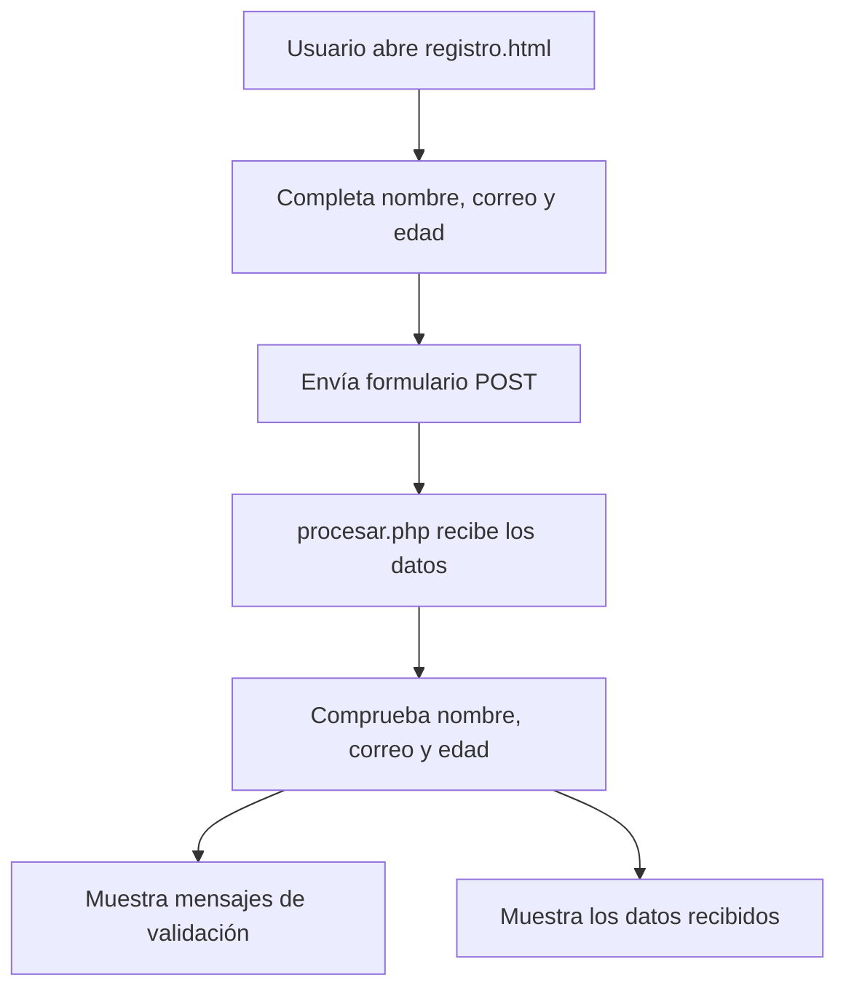

# Práctica 1 — Fundamentos de PHP


Colección de ejercicios introductorios de PHP para practicar variables, arrays, condicionales, bucles, formularios HTML y tratamiento de datos enviados mediante `POST`.

## Características

- Presentación de datos personales mediante variables PHP.
- Generación de una tabla de multiplicar.
- Recorrido de un array de alumnos, cálculo de notas y promedio.
- Formulario de registro HTML y procesamiento de datos con PHP.
- Agenda de contactos con formulario y tabla HTML.

## Archivos del proyecto

| Archivo | Función |
| --- | --- |
| `presentacion.php` | Muestra nombre, edad y ciudad definidos en variables. |
| `tabla.php` | Genera la tabla de multiplicar del número 5. |
| `alumnos.php` | Recorre alumnos y notas, muestra una clasificación y calcula la media. |
| `registro.html` | Formulario para introducir nombre, correo y edad. |
| `procesar.php` | Recibe el formulario por `POST`, valida campos y muestra una respuesta. |
| `agenda.php` | Recibe un contacto por `POST` y lo muestra en una tabla. |
| `bienvenida.php` | Archivo PHP sin funcionalidad implementada todavía. |
| `logout.php` | Archivo PHP sin funcionalidad implementada todavía. |

## Tecnologías utilizadas

| Tecnología | Uso |
| --- | --- |
| PHP | Lógica de los ejercicios y procesamiento de formularios. |
| HTML5 | Estructura de los formularios y tablas. |
| Servidor con PHP | Ejecución local de los scripts. |

## Requisitos

- PHP instalado (con servidor web compatible o servidor integrado de PHP).
- Navegador web.
- Editor de código, como VS Code o PhpStorm.

## Instalación y ejecución

1. Descarga o descomprime el proyecto.
2. Abre una terminal en la carpeta `Practica1`.
3. Inicia el servidor de desarrollo de PHP:

   ```bash
   php -S localhost:8000
   ```

4. Abre en el navegador `http://localhost:8000/registro.html` para probar el formulario.
5. Accede a los demás ejercicios mediante sus rutas, por ejemplo `http://localhost:8000/tabla.php` o `http://localhost:8000/agenda.php`.

> [!NOTE]
> El servidor integrado de PHP es adecuado para pruebas locales, no para publicar directamente en producción.

> [!WARNING]
> La práctica contiene funcionalidades incompletas y errores de validación. No debe utilizarse con datos reales ni publicarse como aplicación de producción sin revisarla.

## Funcionamiento del formulario



El diagrama representa el flujo previsto del ejercicio. Actualmente, `procesar.php` imprime mensajes de error, pero no los almacena en un array `$errores`; por eso su comprobación final no distingue correctamente los formularios válidos de los inválidos.

## Estado y tareas pendientes

- [x] Crear los ejercicios de variables, bucles y arrays.
- [x] Crear el formulario HTML de registro.
- [x] Implementar una primera versión del procesamiento por `POST`.
- [x] Crear una agenda básica con formulario y tabla.
- [ ] Corregir la clasificación de notas en `alumnos.php` (la condición `>= 5` está asociada a «Suspenso»).
- [ ] Acumular correctamente los errores de validación en `procesar.php`.
- [ ] Escapar la salida de los contactos en `agenda.php`.
- [ ] Conservar los contactos entre peticiones si se desea una agenda persistente.
- [ ] Implementar `bienvenida.php` y `logout.php`, si forman parte del objetivo de la práctica.
- [x] Añadir licencia MIT y normas de contribución.

## Preguntas frecuentes

<details>
<summary>¿Necesito instalar una base de datos?</summary>

No. Los ejercicios actuales utilizan variables y arrays PHP; no incluyen conexión a una base de datos.

</details>

<details>
<summary>¿Por qué desaparecen los contactos al recargar la agenda?</summary>

Porque el array `$contactos` se inicializa vacío en cada petición. No hay almacenamiento en sesión ni en base de datos.

</details>

## Autoría

**Rafael Vega Librero** — Práctica de PHP.

## CHANGELOG

[CHANGELOG]([changelog](https://github.com/Rafael1570/Ejercicio_Readme/blob/main/changelog.md))

## Licencia

Este proyecto se distribuye bajo la **licencia MIT**. Consulta el archivo
[LICENSE](LICENSE) para leer sus condiciones completas.

Se ha elegido MIT porque es una licencia sencilla y permisiva, apropiada para
una práctica educativa: permite estudiar, utilizar, modificar y compartir el
código, incluso en otros proyectos, siempre que se conserve el aviso de
copyright y el texto de la licencia. El software se ofrece sin garantías.

## Contribuciones

Las normas para proponer cambios y corregir errores están en
[CONTRIBUTING.md](CONTRIBUTING.md).

## Nota técnica

Esta documentación se ha elaborado a partir de los archivos reales de `Practica1.zip`. Describe el comportamiento existente y señala las partes que necesitan mejoras, sin dar por implementadas funcionalidades que no aparecen en el código.
